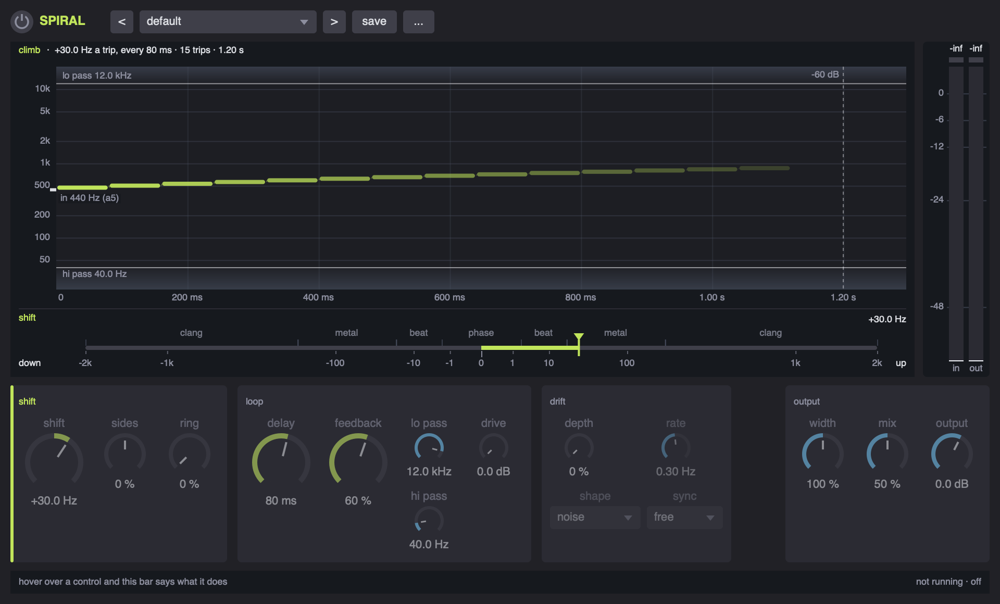

# Spiral

**A frequency shifter in a feedback loop - the sound that keeps climbing and never gets anywhere - running anywhere a UGen does, with a window.** A SuperCollider extension.



```supercollider
s.boot;
Ndef(\tone, { Spiral.ar(SinOsc.ar([220, 221]) * Decay2.kr(Impulse.kr(0.5), 0.01, 0.5) * 0.3, \spiral) }).play;

p = Spiral(Ndef(\tone), \spiral);
p.gui;
p.shift = 40; p.feedback = 0.8; p.delay = 0.08;
p.sides = 1;                     // the sides go opposite ways
p.preset = 'barber pole';
```

Every effect of this family lives in the same three places. Write `Spiral.ar` into a graph of your own and drive it from the object, as above; give it a node of its own on a bus, `Spiral.onBus(0, 2).enabled_(true)`; or put it in a chain, `FxChain.master.add(Spiral())`. If SuperDirtGUI is installed, it is an insert on an orbit too: `~sdg.addInsert(0, \spiral)`.

It is built on [FxKit](../sc%20fx%20kit), which is built on [ParaEQ](../sc%20EQ), and the class library will not compile without them; the installer links both when the folders sit side by side. It uses SuperCollider's own UGens, not sc3-plugins.

Written for SuperCollider 3.13 on macOS. Nothing in it is platform specific apart from the symlink in `install.scd`, which Linux shares and Windows does not.

## Install

### As a quark

```supercollider
Quarks.install("https://github.com/fracnesco/sc-spiral.git");
thisProcess.recompile;
```

The manifest names `sc-fx-kit` as a dependency, which names `sc-eq`, so `Quarks` fetches those first. The quark goes by the name of the repository, `sc-spiral`; the class inside it is `Spiral`.

### From a clone

Clone `sc-eq` into a folder called `sc EQ`, `sc-fx-kit` into `sc fx kit` and this into `sc spiral`, side by side. Open `install.scd` and evaluate its first block, then recompile the class library. It links what is missing and tells you what it did.

On Windows there is no `ln -s`, so use the quark, or copy the three folders into the extensions folder by hand: `Platform.userExtensionDir.openOS` opens it.

Install it one way or the other, **not both**: two copies on the class path is a duplicate class error at compile time.

### Check that it took

```supercollider
Spiral.presetNames;
Spiral.onBus(0, 2).enabled_(true).gui;
```

Select `Spiral` and press cmd/ctrl + d for the help file, and see [examples/spiral-demo.scd](examples/spiral-demo.scd) for a walkthrough you can evaluate a block at a time.

## What it does

A pitch shifter multiplies every partial; a frequency shifter adds the same number of Hz to each, so harmonics stop being harmonics. In a loop, each trip moves the sound further: `shift` is how far, `delay` how long a trip takes, and `feedback` how many trips it survives. `damp` and `loCut` are the walls climbing and falling notes die out against.

`sides` sends the sides apart, and at 100% in opposite directions. `ring` fades over to ring modulation at the same frequency, which goes both ways at once. `driftDepth` makes the shift wander.

The knob for `shift` is fine near 0 and coarse at the ends (`FxCubeWarp`), since 0.5 Hz and 500 Hz are both things you want.

A loop of less than a block is not possible without `LocalIn`, which the family does not use: the shortest `delay` is about 1.4 ms at 48 kHz and 64 samples.

## The window

`p.gui` opens it (`p.panel(view)` puts the same thing in a view of yours): the top row (on, presets, save, the menu with copy and paste), the display with the in and out meters beside it, and one row of cards. Hover over anything and the bar at the bottom says what it does.

The display is **the climb**: where a note at 440 Hz (a5) goes, trip by trip round the loop. Hz go up on a log scale, seconds along, so the slope is the shift and the length of the train is the feedback.

- **the trail**: one bar per trip, at the pitch the shifter has put the note at by then, as long as a trip takes (`delay`) and as bright as the feedback leaves it. A shift under 0 falls, and a note shifted through 0 Hz folds back up.
- **the walls**: `damp` (lo pass) at the top and `loCut` (hi pass) at the bottom, with what lies beyond them shaded. A climbing note dies out against the top one, a falling note against the bottom one.
- **the end line**: where the train has died out (-60 dB), or "goes on" when the loop holds it up (feedback past 100, or drive).
- with `sides`, the right side's trail is hollow; with `ring`, every trip goes up and down at once and the note spreads into more and more partials; with `driftDepth`, an orange band is how far the trail wanders.
- a short loop with a small shift is a comb whose teeth slide (the barber pole): the caption says so and draws the teeth.
- behind it, at the left edge, the output's spectrum lies on its side, and while the window is running the trail sways with the drift as the server has it.

Under it, **the shift strip** is the shift on the knob's own scale: 0 in the middle, down to the left, up to the right, with the words for what a shift that size does to a held sound (phase, beat, metal, clang). The filled needle is the left side (or the only one), the hollow one the right side.

| in the display | does |
|---|---|
| drag the climb | up and down: `shift`; along: the trips stretch (`delay`) - the time axis holds still while you drag |
| drag the end line | `feedback`: where the train dies out |
| drag a wall | `damp` (top) or `loCut` (bottom) |
| drag the strip | `shift`, the needle follows the pointer and 0 sticks in the middle |
| drag the hollow needle | `sides` |
| the wheel | `feedback`; on the strip `shift`, on a wall that wall |
| shift | fine, a tenth as far |
| double click | back to the default of what is under it |

Hovering a part of the display lights the knobs that set it, and hovering a knob lights its part.

The cards, left to right: *shift*, in the pitch family's lime - shift (a big knob from 0, its value with a sign: "+24.0 Hz", "-1.50 kHz"), sides and ring; *loop* - delay and feedback, the two other big knobs, lo pass over hi pass, and drive (delay and drive dim at no feedback, since nothing goes round); *drift* - depth, shape, rate and sync (dim while depth is 0; the rate also dims while sync follows Tidal's clock); *output* - width, mix and output.

## Presets

Built in: default, barber pole, falling, opposite ways, detuned air, phasing, bell ring, alien radio, roar.

Yours go in `Platform.userAppSupportDir/spiral-presets.scd`: `p.saveAsPreset("mine")`, or press save in the window and give it a name. `p.copySettings` and `other.pasteSettings` carry settings from one to another.

## Parameters

Every parameter is a property: `p.shift`, `p.shift = ...`. These also work by name, `p.set(\shift, ...)`, `p.get(\shift)`. Knobs clip to their range. This table is generated from the class.

| parameter | section | range | default | what it does |
|---|---|---|---|---|
| `shift` | shift | -2000 .. 2000 Hz | 30 | how far each trip moves every partial, in Hz: up, or down below 0 |
| `sides` | shift | -1 .. 1 | 0 | the sides apart: at 50 the right one stands still, at 100 it goes the opposite way |
| `ring` | shift | 0 .. 1 | 0 | over to ring modulation: up and down at once |
| `driftDepth` | drift | 0 .. 1 | 0 | how far the shift wanders, as a part of itself |
| `driftShape` | drift | sine triangle sawUp sawDown square sampleHold noise | noise | how the shift wanders |
| `driftRate` | drift | 0.01 .. 12 Hz | 0.3 | how quickly it wanders |
| `feedback` | loop | 0 .. 1.05 | 0.6 | how many trips it survives - past 100, it builds to a roar |
| `delay` | loop | 0.0015 .. 2 s | 0.08 | how long a trip round the loop takes |
| `damp` | loop | 200 .. 20000 Hz | 12000 | a low pass in the loop: climbing notes die out at the top |
| `loCut` | loop | 20 .. 4000 Hz | 40 | a high pass in the loop: falling notes die out at the bottom |
| `drive` | loop | 0 .. 24 dB | 0 | how hard the loop saturates: it holds a long loop up |
| `width` | output | 0 .. 2 | 1 | how far apart the sides are |
| `mix` | output | 0 .. 1 | 0.5 | how much of the effect goes out, against the dry signal |
| `output` | output | -36 .. 24 dB | 0 | the level of the whole thing, in dB |
| `driftSync` | drift | free four two one half quarter eighth sixteenth third sixth twelfth | free | the drift free, at its rate - or one period every so many cycles of Tidal's clock |

## Files

| file | what it is |
|---|---|
| [classes/Spiral.sc](classes/Spiral.sc) | the parameters, the presets, the DSP |
| [classes/SpiralView.sc](classes/SpiralView.sc) | the window's display, the shift's knob and the device panel (`SpiralView`, `SpiralShiftKnob`, `SpiralPanel`) |
| [HelpSource/Classes/Spiral.schelp](HelpSource/Classes/Spiral.schelp) | the help file |
| [HelpSource/Classes/SpiralView.schelp](HelpSource/Classes/SpiralView.schelp) | the help file for the display |
| [HelpSource/Classes/SpiralPanel.schelp](HelpSource/Classes/SpiralPanel.schelp) | the help file for the device panel |
| [examples/spiral-demo.scd](examples/spiral-demo.scd) | a walkthrough, one block at a time |
| [install.scd](install.scd) | the symlink, a check, an uninstall |
| [sc-spiral.quark](sc-spiral.quark) | the quark manifest |
| [images/](images/) | the screenshots in this README |

## License

MIT - see [LICENSE](LICENSE).
